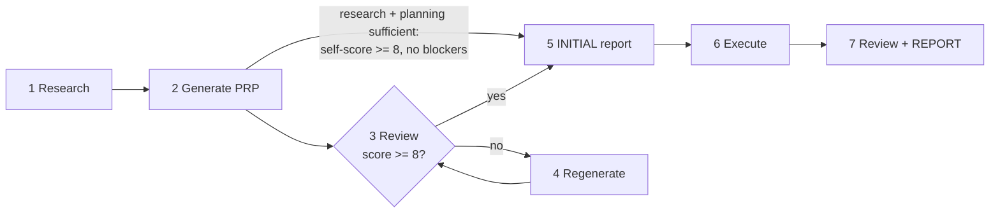

# PRP Workflow

A PRP (Product Requirements & Planning document) is a context-rich, self-validating implementation specification. The goal is **one-pass implementation success through comprehensive context**: the executing agent gets only the PRP plus its training data, so every research finding, codebase pattern, gotcha, and validation command must be included in or referenced from the PRP.

This skill is project-agnostic. It prescribes the PRP *process*; the host project supplies the specifics — its name, its rules, its subagents, its tooling, its validation commands. See **Project adaptation** below.

## Lifecycle

The PRP process has seven stages. Determine which stage the user is requesting and read the matching reference file before doing the work.

| # | Stage | Trigger examples | Reference |
|---|-------|------------------|-----------|
| 1 | Research | "research X for a PRP", start of any PRP generation | [references/research.md](references/research.md) |
| 2 | Generate PRP | "create/generate a PRP for X" | [references/generate.md](references/generate.md) |
| 3 | Review PRP *(skippable)* | "review this PRP", after generation | [references/review-regenerate.md](references/review-regenerate.md) |
| 4 | Regenerate PRP *(skippable)* | "improve/update the PRP", after review findings | [references/review-regenerate.md](references/review-regenerate.md) |
| 5 | Initial Report | "create the INITIAL report", before execution | [references/initial-report.md](references/initial-report.md) |
| 6 | Execute PRP | "execute/implement the PRP" | [references/execute.md](references/execute.md) |
| 7 | Work Review + Final Report | "write the completion REPORT", after implementation | [references/final-report.md](references/final-report.md) |

Stages run in order for a full feature cycle. Stages 3-4 are an iterative quality loop that normally runs until the PRP scores at least 8/10 on the review rubric, but the loop is skippable when research and planning are already sufficient (see "Skipping the review loop" below). Stage 5 is a mandatory gate before Stage 6 and is never skippable: never begin execution without a current `*-INITIAL.md` report. Stage 7 closes the cycle.



### Skipping the review loop

This is the one place the skip gate is stated; the stage references point here rather than restating it.

The Stage 3-4 review/regenerate loop exists to catch gaps that would break a one-pass implementation. When Stage 1 research was genuinely thorough and Stage 2 already produced a high-confidence PRP, that loop is redundant and the developer may skip directly from Stage 2 to Stage 5. Skipping is a deliberate, honestly-gated decision — never a default shortcut to save time on a PRP that has not earned it.

Skip only when ALL of the following hold: the developer explicitly opts in (or a request such as "generate and execute", "skip the review", or "if the plan is solid, proceed" makes the intent clear); Stage 1 research is complete with every file path and documentation URL already verified against the repo during generation; the Stage 2 self-score is >= 8/10 with no open blockers; and the feature is not high-risk or novel enough to demand an independent adversarial pass (new auth/security surfaces, data migrations that are hard to reverse, or cross-cutting architectural changes still warrant the full loop even at a high self-score). If any condition is in doubt, run the loop.

When the loop is skipped, say so explicitly to the developer with the self-score and the reason, and record it in the Stage 5 INITIAL report's **Review Status** field so the decision is auditable. A skip never lowers the 8/10 bar — it asserts the bar was already met at generation, it does not waive it.

## Conventions (apply to every stage)

**Project adaptation.** Resolve the host project's specifics before writing anything, and never carry another project's names, tools or house rules into a document:

| What | Where to resolve it from | Fallback if the project defines none |
|------|--------------------------|--------------------------------------|
| Project name (document headings) | the first heading in `README.md` | ask the developer |
| Project rules and standards | `CLAUDE.md` / `AGENTS.md` and what they import | this skill's Quality bars |
| Task tracking taxonomy | the project's own task-tracking rules | [task-tracking.md](references/task-tracking.md) defaults |
| Available subagents | `.claude/agents/` | a general-purpose agent |
| Code-intelligence tooling | the project's rules (e.g. a language-server MCP) | Grep / Glob |
| Knowledge base / research tooling | the project's rules — what it mandates for docs lookup and web search | the agent's own web search |
| Validation commands | `package.json`, `Makefile`, `pyproject.toml`, CI config | ask the developer |
| PRP artifact root | the project's existing layout | `PRPs/`, `PRPs/reports/`, `PRPs/complete/` |
| Scratch / working-notes directory | the project's existing layout | `wip/` |
| Document header + footer spec | the project's documentation rules | the fields named in each stage reference |
| Timestamp format and timezone | the project's documentation rules | `dd/MM/yyyy HH:mm <local TZ>` |
| Commit message convention | the project's git rules | `feat(scope): description (P#S#)` |

Where the project defines a rule, the project wins. Where it defines none, the fallback stands. Never invent a project convention — if a needed specific cannot be resolved from the table above, ask the developer.

**Identifiers.** PRPs are identified as `P#S#` (Phase-Step, e.g. `P44S1`); tasks within a PRP as `P#S#T#` (e.g. `P44S1T3`). These identifiers are NOT guaranteed unique — a project may have reused a `P#S#` for unrelated features historically (check for a clash table in the project's task documentation). NEVER renumber an existing clashing ID: the numbers are embedded in git history, source-code file-header changelogs, docs, and GitHub issue bodies (and, before the move to the `adopt-github-issues` standard, issue titles), so renumbering falsifies provenance. This is also why the GitHub issue NUMBER — allocated by GitHub and unable to collide — is the stable handle for a task, and the `PRP: <filename> T#` line on its body is a cross-reference, not the identity. A PRP is tracked as one epic issue whose tasks are its sub-issues. Always refer to a PRP by its FILENAME (feature slug, e.g. `P44S1-user-invite-flow` or its `-INITIAL`/`-REPORT` companion), never by a folder path — completed PRPs are archived at Stage 7, so paths go stale but filenames are stable. Before creating a new PRP, allocate the next GENUINELY unused `P#S#` by listing BOTH folders — never assume the next sequential number is free:

```bash
ls PRPs/ PRPs/complete/ 2>/dev/null | grep -oE '^P[0-9]+S[0-9]+' | sort -u
```

**File locations and naming** (lower-hyphen-case feature names; roots per the adaptation table):

| Artifact | Location | Pattern |
|----------|----------|---------|
| PRP (in flight) | `PRPs/` | `P#S#-feature-name.md` |
| PRP (completed) | `PRPs/complete/` | archived there by Stage 7 |
| INITIAL report | `PRPs/reports/` | `P#S#-feature-name-INITIAL.md` |
| REPORT | `PRPs/reports/` | `P#S#-feature-name-REPORT.md` |
| Guides / working docs | `PRPs/docs/` | free-form, referenced from a PRP |
| WIP / test / debug files | `wip/` | `P#S#-description.md` |

**Document formatting.** Every PRP and report MUST carry: the source header the project's documentation rules define, the `# {Project name}` / `## {Title}` heading pair (project name resolved as above), the title/created/modified table, and a Table of Contents with anchor links. Use the project's timestamp format and timezone, and get real times from a real clock (a `time` MCP tool where available, else `date`) — never guess. Where the project defines a per-document-type footer spec, validate against its checklist before finalizing; otherwise use the footer fields named in each stage's reference. Write body content as flowing prose, not fragmented bullet lists.

**Task tracking is GitHub Issues.** Every task in a PRP is a GitHub issue, worked through the `gh` CLI. The PRP and its reports carry the plan and the rationale; the issue carries the state. Read [references/task-tracking.md](references/task-tracking.md) before Stage 5, Stage 6 and Stage 7 — it is the whole contract, and no other file restates it.

**Subagents.** Every stage assigns work to the most-aligned subagent the project actually offers — read `.claude/agents/` to see what exists rather than assuming a roster. Tasks marked `[P]` in a task list are parallelizable — spawn those subagents concurrently in a single message.

**Quality bars.** No placeholders, mock data, backwards compatibility, or workarounds — ever. Keep every file within the project's code-size bands (where it sets none: prefer 300 lines, decide past 600). Meet the project's coverage bar (80%+ where it sets none). Run lint/typecheck before commits. TDD approach. No marketing language in any document; be critical and realistic about completeness, and document only verified facts — no speculation.

## Resources

- [references/research.md](references/research.md) — Stage 1: what to gather and from where.
- [references/generate.md](references/generate.md) — Stage 2: PRP structure, required sections, scoring.
- [references/review-regenerate.md](references/review-regenerate.md) — Stages 3-4: the adversarial rubric and the edit loop.
- [references/initial-report.md](references/initial-report.md) — Stage 5: the execution plan of record.
- [references/execute.md](references/execute.md) — Stage 6: how the implementation is run.
- [references/final-report.md](references/final-report.md) — Stage 7: the work review, completion report and archive.
- [references/task-tracking.md](references/task-tracking.md) — the GitHub Issues contract; read it at Stages 5, 6 and 7.
