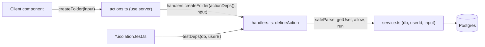

# PromptHub
## P7S2 Action Contract

| `Title` | `Created` | `Last modified` |
|---------|-----------|-----------------|
| P7S2 Action Contract | 27/10/2026 00:35 GMT+10 | 27/10/2026 00:35 GMT+10 |

## Table of Contents
- [Purpose](#purpose)
- [Layers](#layers)
- [The Runner](#the-runner)
- [Dependencies and Defaults](#dependencies-and-defaults)
- [Auth Handlers](#auth-handlers)
- [Action Table](#action-table)
- [Messages](#messages)
- [Module Map](#module-map)
- [Isolation Test Convention](#isolation-test-convention)
- [Coverage Scope](#coverage-scope)

## Purpose

This is the interface contract for [the P7S2 PRP](../P7S2-server-side-security-hardening.md). It fixes the layers every
server action is built from, the TypeScript shapes of the runner and its dependencies, the input, result, rate limit and
callers of each of the 25 actions that remain, the fixed messages, the files and their line budgets, and the test naming
the inventory test enforces. The per-task steps are in [the task briefs](P7S2-task-briefs.md). Where a brief and this
contract disagree on an interface, this contract wins. Every path and line below was read at `bff5fa6` on 27/10/2026.

## Layers

Every action is three layers, extending the service convention of P7S1 (`docs/rules/project.md#files-and-documents`):

| Layer | File | Holds | Imports | Tested |
|---|---|---|---|---|
| Action | `src/features/<f>/actions.ts`, `"use server"` | One wrapper per action: `return handlers.<name>(actionDeps(), input)` | `@/lib/action-deps`, `./handlers` | Not directly: the wrapper is one line; the inventory test checks its shape |
| Handler | `src/features/<f>/handlers.ts`, `import "server-only"` | One `defineAction(...)` spec per action: schema, limit, messages, revalidation, the service call | `@/lib/action-runner`, `./schemas`, `./service` | Against Postgres, with a fake `getUser` (`*.isolation.test.ts`) |
| Service | `src/features/<f>/service.ts` (and topic services), `import "server-only"` | Functions taking `(db, userId, input)`; every statement scoped by `user_id` | `@prisma/client` types, `@/lib/ensure-profile` | Against Postgres |

A handler module never imports `@/lib/db`, `@/lib/action-deps`, `@/lib/supabase/*` or `next/headers`, so a test can
import it. Only an `actions.ts` imports `@/lib/action-deps`.



The diagram is not rendered (the project has no render step).

## The Runner

`src/lib/action-runner.ts` (plain module, `import "server-only"`):

```typescript
import "server-only"
import type { PrismaClient } from "@prisma/client"
import { z } from "zod"
import type { ActionResult } from "@/types/actions"

/** The authenticated user as an action sees it. */
export interface SessionUser { id: string; email: string }

/** The in-memory limiter buckets (`src/lib/rate-limit.ts`). */
export type RateBucket = "auth" | "mutation" | "autosave"

/** What a handler needs from the request; `actionDeps()` supplies the real ones, `testDeps()` the test ones. */
export interface ActionDeps {
  /** The database; the real client in production, the `useTestDatabase` client in tests. */
  db: PrismaClient
  /** The user from `supabase.auth.getUser()`, or null when there is no valid session. */
  getUser(): Promise<SessionUser | null>
  /** True when a request in `bucket` for `key` is within its limit (and records it). */
  allow(bucket: RateBucket, key: string): boolean
  /** `revalidatePath` in production; a no-op in tests. */
  revalidate(path: string, type?: "layout" | "page"): void
}

/** One action, declared once and run by `defineAction`. */
export interface ActionSpec<S extends z.ZodTypeAny, T> {
  /** The action's exported name; used in the error log line. */
  name: string
  /** Parses the raw argument; an action without input uses `noInput`. */
  schema: S
  /** The bucket to charge, keyed by user id; omitted for a read. */
  limit?: "mutation" | "autosave"
  /** Returned when the schema rejects the input; defaults to INVALID_INPUT. */
  invalid?: string
  /** Returned when anything throws (after the redirect check). */
  failure: string
  /** Revalidated after a successful run, as the current action does. */
  revalidate?: { path: string; type?: "layout" | "page" }
  /** The body: called with the validated input and the authenticated user. */
  run(db: PrismaClient, user: SessionUser, input: z.output<S>): Promise<ActionResult<T>>
}

export const INVALID_INPUT = "Invalid input data"
export const UNAUTHORIZED = "Unauthorized. Please sign in."
export const RATE_LIMITED = "Too many requests. Please slow down."
/** The schema of an action that takes no argument: anything but undefined is rejected. */
export const noInput = z.undefined()

export function defineAction<S extends z.ZodTypeAny, T>(
  spec: ActionSpec<S, T>,
): (deps: ActionDeps, raw: unknown) => Promise<ActionResult<T>>

/** Rethrows Next's redirect and not-found errors; the one copy of the NEXT_REDIRECT rule (#51). */
export function rethrowIfRedirect(error: unknown): void
```

The function `defineAction` returns runs these steps in order, all inside one `try`:

1. `spec.schema.safeParse(raw)`; on failure return `{ success: false, error: spec.invalid ?? INVALID_INPUT }`.
2. `await deps.getUser()`; null returns `UNAUTHORIZED`.
3. When `spec.limit` is set, `deps.allow(spec.limit, user.id)`; false returns `RATE_LIMITED`.
4. `const result = await spec.run(deps.db, user, parsed.data)`.
5. When `result.success` and `spec.revalidate` is set, `deps.revalidate(path, type)`.
6. Return `result`.

The `catch` calls `rethrowIfRedirect(error)`, logs `console.error(\`${spec.name} error:\`, error)` and returns
`{ success: false, error: spec.failure }`. `rethrowIfRedirect` uses `isRedirectError` from
`next/dist/client/components/redirect` and `isNotFoundError` from `next/dist/client/components/not-found` (both exist
in Next 14.2.35). It replaces the eleven inline `error.message === "NEXT_REDIRECT"` blocks, which also miss Next's
`digest`-based check.

## Dependencies and Defaults

`src/lib/action-deps.ts` (plain module, `import "server-only"`), imported only by `actions.ts` files:

```typescript
/** The real dependencies of a request: called inside each action, never at module load (cookies() needs a request). */
export function actionDeps(): ActionDeps
// db: the default export of @/lib/db
// getUser: (await createClient().auth.getUser()).data.user, mapped to { id, email: email ?? "" }, or null
// allow: "auth" -> checkAuthRateLimit, "mutation" -> checkMutationRateLimit, "autosave" -> checkAutosaveRateLimit
// revalidate: revalidatePath from next/cache

/** The real dependencies of signIn and signUp. */
export function authDeps(): AuthDeps
```

`src/lib/rate-limit.ts` gains `checkAutosaveRateLimit` on a new `"autosave"` limiter of 120 requests per 60,000 ms per
user. `"mutation"` stays at 30 per 60,000 ms, shared by every other mutation of one user. The limiter's eviction and
shared store stay with #48.

`src/test/action-deps.ts` (test helper, no `server-only` import needed):

```typescript
/**
 * Dependencies for a handler under test: the test database, a fixed user (null for signed out), every request allowed
 * unless `allow` is given, and revalidation recorded in `revalidated`.
 */
export function testDeps(
  db: PrismaClient,
  user: { id: string; email?: string } | null,
  options?: { allow?: ActionDeps["allow"] },
): ActionDeps & { revalidated: Array<{ path: string; type?: string }> }
```

`src/test/db.ts` gains `createTestFolder(db, userId, { name?, parentId? })` and `createTestTag(db, userId, name)`,
documented like the existing factories. `useTestDatabase` also checks the `Folder` and `Tag` tables exist.

## Auth Handlers

`signIn` and `signUp` hold no tenant data and do not fit `defineAction` (no user yet). `src/features/auth/handlers.ts`
(`import "server-only"`):

```typescript
export interface AuthDeps {
  /** The Supabase auth client; only these two methods are used, with exactly { email, password }. */
  auth: {
    signInWithPassword(c: { email: string; password: string }): Promise<AuthReply>
    signUp(c: { email: string; password: string }): Promise<AuthReply>
  }
  /** The client address used as the rate-limit key: the first x-forwarded-for value, or "unknown". */
  clientIp(): string
  allow: ActionDeps["allow"]
  /** ensureProfileExists(db, userId) in production. A failure is logged and does not fail the sign-in. */
  ensureProfile(userId: string): Promise<void>
  revalidate: ActionDeps["revalidate"]
}
type AuthReply = {
  data: { user: { id: string } | null }
  error: { status?: number; code?: string } | null
}
export function signIn(deps: AuthDeps, raw: unknown): Promise<ActionResult<{ redirectTo: string }>>
export function signUp(deps: AuthDeps, raw: unknown): Promise<ActionResult<{ redirectTo: string }>>
```

Order: rate limit by `clientIp()` (before parsing, as today), `safeParse` with `SignInSchema` or `SignUpSchema`, call
Supabase with `{ email, password }` built from the parsed data (never the raw object, never `confirmPassword`), map any
error to a fixed message ([Messages](#messages)), `ensureProfile` when a user id came back, `revalidate("/", "layout")`,
return `{ redirectTo: "/dashboard" }`. A thrown error returns the fixed unexpected message, never `error.message`.
`signOut` stays in `actions.ts` unchanged apart from its stale comment (DR-16); it has no handler.

## Action Table

The 25 actions after P7S2 (27 today, less `searchPrompts` and `ensureProfileExists`). `searchPrompts` stops being an
action (decision D9 of the PRP): its body becomes `searchPromptIds(db, userId, input)` in
`src/features/prompts/search-service.ts`, called only by `getPromptsByFolder`. "Limit" is the bucket; "-" is none.
Callers are the lines to change; "none" means the call already passes an object and reads an `ActionResult`.

| Feature | Action | Input schema | Success data | Limit | Callers to change |
|---|---|---|---|---|---|
| folders | `getRootFolders` | `noInput` | `Folder[]` | - | `FolderTree.tsx:29` |
| folders | `createFolder` | `createFolderSchema` `{ name: folderName, parentId: uuid \| null }` | `Folder` | mutation | `FolderToolbar.tsx:24`, `FolderTree.tsx:62`, `FolderItem.tsx:133` |
| folders | `renameFolder` | `renameFolderSchema` `{ folderId: uuid, name: folderName }` | `Folder` | mutation | `FolderToolbar.tsx:36`, `FolderItem.tsx:69` |
| folders | `deleteFolder` | `folderIdSchema` `{ folderId: uuid }` | `{ folderIds: string[]; promptIds: string[] }` | mutation | `FolderToolbar.tsx:49`, `FolderItem.tsx:97` |
| folders | `getFolderChildren` | `{ parentId: uuid }` | `Folder[]` | - | `FolderItem.tsx:45` |
| prompts | `getPromptsByFolder` | `listPromptsSchema` `{ folderId: uuid, query?: trim max 200, tagIds: uuid[] max 20 default [] }` | `PromptListItem[]` | - | `PromptList.tsx:77` |
| prompts | `createPrompt` | `createPromptSchema` (unchanged) | `PromptListItem` | mutation | none |
| prompts | `getPromptDetails` | `getPromptDetailsSchema` | the prompt with `folder: { id, name } \| null`, no `tags` field (#51) | - | none |
| prompts | `renamePrompt` | `renamePromptSchema` `{ promptId: uuid, title: renameTitle }` | `void` | mutation | `DocumentToolbar.tsx:164` |
| prompts | `deletePrompt` | `promptIdSchema` `{ promptId: uuid }` | `void` | mutation | `DocumentTab.tsx:137`, `DocumentToolbar.tsx:188` |
| prompts | `validatePrompts` | `{ promptIds: string(1..100)[] max 200 }` | `{ validIds: string[] }` | - | `use-tab-cleanup.ts:60` |
| prompts | `getTags` | `listTagsSchema` | `Tag[]` | - | `DocumentToolbar.tsx:106` |
| prompts | `createTag` | `createTagSchema` | `{ id, name }` | mutation | none |
| prompts | `assignTagsToPrompt` | `assignPromptTagsSchema` | `void` | mutation | none |
| prompts | `getPromptVersionHistory` | `getPromptVersionHistorySchema` | `PromptVersionHistoryItem[]` | - | none |
| prompts | `restorePromptVersion` | `restorePromptVersionSchema` | `{ title, content }` | mutation | none |
| editor | `saveNewVersion` | `saveNewVersionSchema`, then `titleValidationSchema` inside `run` | `{ versionId }` | mutation | none |
| editor | `autoSavePrompt` | `autoSaveSchema` | `void` | autosave | none |
| profile | `getProfileDetails` | `noInput` | `{ id, email, displayName, createdAt }` | - | `profile/page.tsx:22` |
| profile | `updateDisplayName` | `{ displayName: trim max 50 }` | `{ displayName }` | mutation | `profile/page.tsx:41` |
| workspace | `getWorkspaceSnapshot` | `noInput` | `{ userId, folders, prompts, loadedAt }` | - | `WorkspacePreloader.tsx:27` |
| dashboard | `getDashboardMetrics` | `noInput` | `DashboardMetrics` | - | `dashboard/page.tsx:22` |
| auth | `signIn` | `SignInSchema` | `{ redirectTo }` | auth (IP) | none |
| auth | `signUp` | `SignUpSchema` | `{ redirectTo }` | auth (IP) | none |
| auth | `signOut` | none | redirects to `/login` | - | `Header.tsx:41` (purge first) |

Paths: the folder components are under `src/features/folders/components/`, `PromptList.tsx` and `DocumentToolbar.tsx`
under `src/features/prompts/components/`, `DocumentTab.tsx` under `src/features/tabs/components/`,
`use-tab-cleanup.ts` under `src/hooks/`, the pages under `src/app/(app)/`, `WorkspacePreloader.tsx` and `Header.tsx`
under `src/components/layout/`.

Schema fragments, each with `.trim()` before `.min()` and `.max()`:

```typescript
// src/features/folders/schemas.ts
export const folderNameSchema = z.string().trim().min(1, "Folder name required").max(100, "Folder name too long")
// src/features/prompts/schemas.ts; titleValidationSchema itself is unchanged (the editor and its tests use it)
export const renameTitleSchema = z.string().trim().min(1, "Title cannot be empty").max(200, "Title too long")
  .refine((v) => !isPlaceholderTitle(v), "Please provide a custom title for your document")
// src/features/profile/schemas.ts; an empty result is stored as null, as today
export const updateDisplayNameSchema = z.object({ displayName: z.string().trim().max(50, "Display name too long") })
```

Behaviour that each service must hold, beyond scoping every statement by `user_id`:

| Service function | Rule |
|---|---|
| `createFolder` | In one `$transaction`: when `parentId` is set, `findFirst({ where: { id: parentId, user_id } })`; none returns `FOLDER_NOT_FOUND`; then `ensureProfileExists` and the create |
| `renameFolder` | `updateMany({ where: { id, user_id } })`; count 0 returns `FOLDER_NOT_FOUND`; then `findFirstOrThrow` scoped, in the same transaction |
| `deleteFolder` | In one `$transaction`: a recursive CTE (tagged `$queryRaw`) collects the folder and every descendant owned by the user; the prompts in them are read with `folder_id: { in }` and `user_id`; `deleteMany({ where: { id, user_id } })`; count 0 returns `FOLDER_NOT_FOUND`. Returns both id lists |
| `createPrompt` | The folder ownership check of `createFolder`, in the same transaction as the duplicate-title check and the create |
| `renamePrompt` | Unchanged logic, with the parsed `title` |
| `assignTagsToPrompt` | In one `$transaction`: count the owned tags; `prompt.update({ where: { id, user_id }, data: { tags: { set } } })`; Prisma's `P2025` returns `PROMPT_NOT_FOUND` |
| `validatePrompts` | `findMany({ where: { id: { in }, user_id } })` on the bounded list |
| `getTags`, `createTag` | Unchanged logic, moved to `tag-service.ts`; the `P2002` race handling stays |

```sql
-- deleteFolder, inside the transaction; ids are text columns
WITH RECURSIVE tree AS (
  SELECT id FROM "Folder" WHERE id = ${folderId} AND user_id = ${userId}
  UNION ALL
  SELECT f.id FROM "Folder" f JOIN tree t ON f.parent_id = t.id WHERE f.user_id = ${userId}
)
SELECT id FROM tree
```

## Messages

| Constant | Text | Where |
|---|---|---|
| `INVALID_INPUT` | `Invalid input data` | runner default |
| `UNAUTHORIZED` | `Unauthorized. Please sign in.` | runner |
| `RATE_LIMITED` | `Too many requests. Please slow down.` | runner |
| `FOLDER_NOT_FOUND` | `Folder not found or access denied` | folders service, `createPrompt` |
| `PROMPT_NOT_FOUND` | `Prompt not found or access denied` | prompts service, editor service (exists as `NOT_FOUND`) |
| auth: invalid input or any sign-in error | `Invalid email or password.` | `signIn` |
| auth: `code === "email_not_confirmed"` | `Please confirm your email address before signing in.` | `signIn` |
| auth: invalid input or any sign-up error | `Could not create the account. Please check your details and try again.` | `signUp` |
| auth: `code === "weak_password"` | `Please choose a stronger password.` | `signUp` |
| auth: limiter refusal, `status === 429` or `code === "over_request_rate_limit"` | `Too many attempts. Please try again later.` | both |
| auth: thrown error | `An unexpected error occurred` | both |

A missing row and another user's row return the same message everywhere. The existing per-action messages of
`getPromptDetails` (`Prompt not found`, `Invalid prompt ID`), `getPromptVersionHistory` and `restorePromptVersion`
are kept through `invalid` and the service results, so the editor's tests and UI see no change.

## Module Map

Budgets are the line count each file must stay under; every file lands GREEN.

| File | Change | Budget |
|---|---|---|
| `src/lib/action-runner.ts` | new | 120 |
| `src/lib/action-deps.ts` | new | 80 |
| `src/lib/ensure-profile.ts` | rewritten: `ensureProfileExists(db: Pick<PrismaClient, "profile">, userId)`, upsert with `update: { id: userId }` | 40 |
| `src/lib/rate-limit.ts` | autosave limiter | 100 |
| `src/test/action-deps.ts`, `src/test/db.ts` | new; two factories and two table checks | 60; 200 |
| `src/features/auth/{handlers,actions}.ts` | new; thin | 140; 60 |
| `src/features/auth/sign-out-purge.ts` | new (client) | 80 |
| `src/features/folders/{schemas,service,handlers,actions}.ts` | new; new; new; thin | 50; 180; 90; 60 |
| `src/features/prompts/service.ts` | new: list, create, details, rename, delete, validate | 260 |
| `src/features/prompts/search-service.ts` | new: `searchPromptIds` and the hydrating `findMany` | 90 |
| `src/features/prompts/tag-service.ts` | new: `listTags`, `createTag`, `assignTags` | 150 |
| `src/features/prompts/{handlers,actions,schemas}.ts` | new; thin (was 674); three schemas added | 220; 110; 130 |
| `src/features/editor/{handlers,actions}.ts` | new; thin | 70; 60 |
| `src/features/{profile,workspace,dashboard}/{schemas,service,handlers,actions}.ts` | new (profile schemas only); thin actions | 60 each |
| `src/features/workspace/cache.ts` | user binding, `clearWorkspaceCache`, `removeFolderTreeFromCache` | 180 |
| `src/stores/use-tab-store.ts` | `resetTabs()` | 275 |
| `src/app/auth/sign-out/route.ts` | deleted (Q6) | - |

The `DashboardMetrics` type moves to `src/features/dashboard/types.ts`, since a `"use server"` file should export only
async functions.

## Isolation Test Convention

Each feature with tenant actions has `handlers.isolation.test.ts` (prompts has two: `handlers.isolation.test.ts` for
the prompt actions and `tags.isolation.test.ts` for tags and history), under `describeDb` with `useTestDatabase`.
Every test title starts with the action name and a colon, `it("createFolder: user B cannot create under user A's
folder", ...)`. Each action has at least one test in which user B (`testDeps(db, { id: userB })`) passes user A's ids,
or reads with no ids, and gets the not-found message or an empty result while A's rows read back unchanged. An action
that references other rows (a parent folder, a target folder, tags) has one more test for the foreign reference, which
must write nothing.

`src/test/action-inventory.test.ts` runs without a database and asserts:

1. Every file under `src` whose top level holds a `"use server"` directive is a `src/features/<f>/actions.ts`.
2. Every export of those files is an `export async function`, and its body contains `handlers.<sameName>(` (auth:
   `authDeps()` for `signIn` and `signUp`), except `signOut`.
3. Every exported action except `signIn`, `signUp` and `signOut` (no tenant data; covered by
   `src/features/auth/handlers.test.ts`) is the prefix of at least one test title in a `*.isolation.test.ts`, and every
   such prefix names an existing action.

## Coverage Scope

T1 appends to `coverage.include` in `vitest.config.ts`, once (a pattern for a file not yet created matches nothing):
`src/lib/action-runner.ts`, `src/lib/ensure-profile.ts`, `src/features/*/handlers.ts`, `src/features/*/service.ts`,
`src/features/prompts/search-service.ts`, `src/features/prompts/tag-service.ts`, `src/features/*/schemas.ts`,
`src/features/workspace/cache.ts`, `src/features/auth/sign-out-purge.ts`. Each must reach 80% lines, functions,
branches and statements with `TEST_DATABASE_URL` set. `src/lib/action-deps.ts` and the `actions.ts` wrappers are out
of scope: they need a request and hold no logic.
