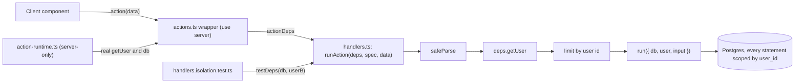

# PromptHub
## P7S2 Action Contracts

| `Title` | `Created` | `Last modified` |
|---------|-----------|-----------------|
| P7S2 Action Contracts | 29/10/2026 16:50 GMT+10 | 30/10/2026 01:13 GMT+10 |

## Table of Contents
- [Purpose](#purpose)
- [The Seam](#the-seam)
  - [Types](#types)
  - [runAction](#runaction)
  - [Wrapper shape](#wrapper-shape)
  - [What the seam leaves untested](#what-the-seam-leaves-untested)
- [Action Matrix](#action-matrix)
- [Schemas](#schemas)

## Purpose

The interfaces and per-action rules for [the PRP](../complete/P7S2-server-side-security-hardening.md), first half: the seam,
the action matrix and the schemas. The per-area contracts (folders, `ensureProfileExists`, auth, prompts, the sign-out
purge, the composite keys and the test conventions) are in [the domain contracts](P7S2-domain-contracts.md). The
decisions behind them are in [the PRP's Decisions](../complete/P7S2-server-side-security-hardening.md#decisions); the task order
and the red tests are in [the task briefs](P7S2-task-briefs.md#briefs). Every file path was read on 29/10/2026 against
`master` at `bff5fa6`. Code here is a contract, not a finished implementation: an executing agent writes the tests
first, checks each cited symbol against the code, and reports a disagreement instead of working around it.

## The Seam

Decision Q1 (developer, 27/10/2026): the body of each action becomes a function of a plain module that takes its
dependencies and its input, and the `"use server"` export becomes a one-line wrapper. A test drives the body with the
`src/test/db.ts` client and a fake `getUser`, so no Next.js internals, no GoTrue and no module mock are involved. This
extends the convention of `src/features/editor/service.ts`, whose functions take `(db, userId, input)`.

There are two layers and they stay distinct. A handler is the body of one action: `(deps, data: unknown)`, which parses,
authenticates, rate-limits and runs. The editor service (`saveVersion`, `listVersions`, ...) remains the lower layer a
handler delegates to when a transaction is worth testing on its own. Every handler and service module imports
`server-only`.

### Types

```typescript
// src/lib/action-runner.ts  (plain module: no "use server", no next/* import; imports "server-only")
import type { PrismaClient } from "@prisma/client"
import type { z } from "zod"
import type { ActionResult } from "@/types/actions"

/** The signed-in user as a handler needs it: id and email from supabase.auth.getUser(). */
export interface ActionUser { id: string; email: string | null }

/** What a handler is given. The real values are built in src/lib/action-runtime.ts; a test passes its own. */
export interface ActionDeps {
  /** Resolves the authenticated user, or null. Real: supabase.auth.getUser() on the request's cookies. */
  getUser: () => Promise<ActionUser | null>
  /** The Prisma client. Real: @/lib/db. A test passes the useTestDatabase client. */
  db: PrismaClient
}

/** Which limiter applies: shared mutation (30/min), save (30/min), autosave (240/min), or none (a read). */
export type LimitClass = "mutation" | "save" | "autosave" | "none"

export interface ActionSpec<I, O> {
  /** Logged with an unexpected error: `${name} error:`. */
  name: string
  /** Parses `data`; a schema with defaults has a wider input than output, hence the third type argument. */
  schema: z.ZodType<I, z.ZodTypeDef, unknown>
  /** The message for a failed parse, e.g. "Invalid prompt ID". Never a Zod message: it can echo the input. */
  invalid: string
  /** The message for an unexpected error, e.g. "Failed to rename prompt". */
  failure: string
  limit: LimitClass
  /** Call ensureProfileExists(db, user.id) after the limit and before `run` (createPrompt, createFolder, profile). */
  ensureProfile?: boolean
  // The sketches in this document write `userId` for `user.id`.
  run: (ctx: { db: PrismaClient; user: ActionUser; input: I }) => Promise<ActionResult<O>>
}
```

### runAction

```typescript
export async function runAction<I, O>(deps: ActionDeps, spec: ActionSpec<I, O>, data: unknown): Promise<ActionResult<O>>
```

The order is fixed and is the order `createPrompt` and `saveNewVersion` use today, so no action changes its observable
order of checks:

```text
1. parsed = spec.schema.safeParse(data)     fail -> { success: false, error: spec.invalid }   (getUser not called)
2. user = await deps.getUser()              null -> { success: false, error: "Unauthorized. Please sign in." }
3. limit (user.id)                          over -> { success: false, error: "Too many requests. Please slow down." }
4. if spec.ensureProfile: await ensureProfileExists(deps.db, user.id)
5. return await spec.run({ db: deps.db, user, input: parsed.data })
catch (error): rethrow when error is an object with a string `digest` (NEXT_REDIRECT, NEXT_NOT_FOUND,
               DYNAMIC_SERVER_USAGE: the control-flow errors Next 14.2 builds with a digest; the one place this check
               lives; issue #51); otherwise console.error(`${spec.name} error:`, error) and return
               { success: false, error: spec.failure }
```

Steps 1 to 5 sit inside the `try`, so a rejected `getUser()` (a cookie or Supabase failure) becomes `spec.failure`. The
tenant boundary is the arguments `run` receives: `user` comes only from step 2 and `input` carries no user id, so a
handler cannot scope a query by a value the client chose.

`checkMutationRateLimit` exists in `src/lib/rate-limit.ts` (30 per 60 s per identifier, store `mutation`). Task 2 adds
`checkSaveRateLimit` (store `save`, 30 per 60 s: `saveNewVersion` and `restorePromptVersion` use it, decision D4,
developer 29/10/2026) and `checkAutosaveRateLimit` (store `autosave`, 240 per 60 s); every other mutation keeps
`mutation`. Autosave writes 500 ms after the last change, so at most 120 writes a minute are possible, and the limit
leaves twice that; the number is a judgement the developer may change. Reads are not limited (decision Q3).

### Wrapper shape



Not rendered (the project has no render step). The tests enter at `H`; nothing automated covers `W` and `X`.

```typescript
// src/features/folders/actions.ts
"use server"

import { revalidatePath } from "next/cache"
import { actionDeps } from "@/lib/action-runtime"
import * as handlers from "./handlers"
import type { CreateFolderInput } from "./schemas"

export async function createFolder(data: CreateFolderInput) {
  const result = await handlers.createFolder(actionDeps, data)
  if (result.success) revalidatePath("/")
  return result
}
```

```typescript
// src/lib/action-runtime.ts  (imports "server-only"; the only module that imports @/lib/db and the Supabase server
// client for actions; no test imports it, because it needs a request's cookies and the developer's DATABASE_URL)
export const actionDeps: ActionDeps = {
  db,
  getUser: async () => {
    const { data: { user } } = await createClient().auth.getUser()
    return user ? { id: user.id, email: user.email ?? null } : null
  },
}
```

Rules for a wrapper file: it exports only `async function`s (a type export is erased and allowed); it imports its
handler module as `import * as handlers from "./<name>"`, whatever the module is called, because the coverage rule of
[Task 10](P7S2-task-briefs-2.md#p7s2t10-isolation-coverage-rule) looks for `handlers.<action>(actionDeps` (`authDeps`
in `auth/actions.ts`); each body delegates once, plus the `revalidatePath` calls that exist today; the parameter type is
`z.input<typeof schema>` so call sites type-check, while the handler still takes `unknown` and parses; an action that
already takes `data: unknown` keeps it.
`createClient()` is called inside `getUser`, never at module load, because `cookies()` throws outside a request.

### What the seam leaves untested

The wrappers, `action-runtime.ts` and the Supabase cookie wiring are not covered by a unit test: they need a request
scope and a GoTrue. The research on 26/10/2026 showed that driving them from a test needs Next internals (the request
async storage, the cookies adapter and a static-generation store) and a fake auth server, and that it bypasses the
`src/test/db.ts` guard. The wrappers are exempt from the per-file coverage target and are checked by the build
(`npm run build` fails on a non-async export of a `"use server"` file), by the manifest count in
[the validation loop](../complete/P7S2-server-side-security-hardening.md#level-3-build-and-browser) and by the browser checks.

## Action Matrix

The 25 actions that remain after the PRP. Today 27 functions are exported from the eight `"use server"` modules;
`ensureProfileExists` stops being an action (Task 1) and `searchPrompts` stops being one (decision D3: its only caller
is `getPromptsByFolder`, verified by search on 29/10/2026). Limit classes: M mutation, S save, A autosave, - none, IP
the existing per-IP auth limiter. "Returns" is the `data` of the success result.

| Action | Wrapper file | Input | Limit | Ownership rule | Returns |
|---|---|---|---|---|---|
| `signUp` | `auth/actions.ts` | `SignUpSchema` | IP | no tenant data | `{ redirectTo }` |
| `signIn` | `auth/actions.ts` | `SignInSchema` | IP | no tenant data | `{ redirectTo }` |
| `signOut` | `auth/actions.ts` | none | - | no tenant data | redirects; keeps its body, no handler, no isolation test |
| `getRootFolders` | `folders/actions.ts` | none | - | `user_id` | `Folder[]` |
| `createFolder` | `folders/actions.ts` | `{ name, parentId \| null }` | M | parent owned, same transaction | `Folder` |
| `renameFolder` | `folders/actions.ts` | `{ folderId, name }` | M | `update` where `{ id, user_id }` | `Folder` |
| `deleteFolder` | `folders/actions.ts` | `{ folderId }` | M | tree scoped by `user_id`; `deleteMany` where `{ id, user_id }` | `{ folderIds, promptIds }` |
| `getFolderChildren` | `folders/actions.ts` | `{ parentId }` | - | `user_id`; a foreign parent gives `[]` | `Folder[]` |
| `getPromptsByFolder` | `prompts/actions.ts` | `{ folderId, query?, tagIds? }` | - | `user_id`; a foreign folder gives `[]` | `PromptListItem[]` |
| `createPrompt` | `prompts/actions.ts` | existing | M | folder owned, same transaction | `PromptListItem` |
| `getPromptDetails` | `prompts/actions.ts` | existing | - | `findFirst` where `{ id, user_id }` | prompt with folder, no `tags` |
| `renamePrompt` | `prompts/actions.ts` | `{ promptId, newTitle }` | M | `updateMany` where `{ id, user_id }` | `void` |
| `deletePrompt` | `prompts/actions.ts` | `{ promptId }` | M | `deleteMany` where `{ id, user_id }` | `void` |
| `validatePrompts` | `prompts/actions.ts` | `{ promptIds }` | - | `user_id` | `{ validIds }` |
| `getTags` | `prompts/tag-actions.ts` | existing | - | `user_id` | `Tag[]` |
| `createTag` | `prompts/tag-actions.ts` | existing | M | `user_id` | `{ id, name }` |
| `assignTagsToPrompt` | `prompts/tag-actions.ts` | existing | M | prompt and tags owned; write scoped | `void` |
| `getPromptVersionHistory` | `prompts/history-actions.ts` | existing | - | service (`listVersions`) | versions |
| `restorePromptVersion` | `prompts/history-actions.ts` | existing | S | service (`restoreVersion`) | `{ title, content }` |
| `saveNewVersion` | `editor/actions.ts` | existing | S | service (`saveVersion`) | `{ versionId }` |
| `autoSavePrompt` | `editor/actions.ts` | existing | A | service (`autoSaveDocument`) | `void` |
| `getProfileDetails` | `profile/actions.ts` | none | - | own profile | `{ id, email, displayName, createdAt }` |
| `updateDisplayName` | `profile/actions.ts` | `{ displayName }` | M | own profile | `{ displayName }` |
| `getWorkspaceSnapshot` | `workspace/actions.ts` | none | - | `user_id` | `{ userId, folders, prompts, loadedAt }` |
| `getDashboardMetrics` | `dashboard/actions.ts` | none | - | `user_id` | `DashboardMetrics` |

Under the developer's strict reading of Q4 (29/10/2026) every action but `signOut` returns `ActionResult`: the eleven
that do not today (the five folder actions, `getPromptsByFolder`, `getTags`, both profile actions,
`getWorkspaceSnapshot` and `searchPrompts`, which is no longer an action) plus `getDashboardMetrics`, whose page renders
zeros when it fails. Only `signOut` keeps its own shape and its body, because it redirects. That makes 24 wrappers over
handlers: 22 tenant actions, each with an isolation test, plus `signIn` and `signUp`, covered by `auth/handlers.test.ts`
titled `"signIn: ..."` and `"signUp: ..."`. `signOut` has no handler and no test of this kind (no tenant data).

The `invalid` and `failure` texts of each spec (the unauthorised and over-limit texts are the runner's). "(existing)"
means the action returns that text today.

| Action | `invalid` | `failure` |
|---|---|---|
| `getRootFolders`, `getWorkspaceSnapshot`, `getProfileDetails`, `getDashboardMetrics` | "Invalid input data" | "Failed to load folders", "...workspace", "...profile", "...dashboard" |
| `createFolder` / `renameFolder` / `deleteFolder` / `getFolderChildren` | "Invalid folder name or parent" / "Invalid folder name" / "Invalid folder ID" / "Invalid folder ID" | "Failed to create folder" / "...rename folder" / "...delete folder" / "Failed to load folders" |
| `getPromptsByFolder` | "Invalid folder ID" | "Failed to load prompts" |
| `createPrompt`, `getPromptDetails` | "Invalid input data", "Invalid prompt ID" (existing) | "Failed to create prompt", "Failed to fetch prompt details" (existing) |
| `renamePrompt` / `deletePrompt` / `validatePrompts` | "Invalid title" / "Invalid prompt ID" / "Invalid prompt list" | "Failed to rename prompt" / "...delete prompt" / "...validate prompts" (existing) |
| `getTags` / `createTag` / `assignTagsToPrompt` | "Invalid input data" (all) | "Failed to load tags" / "Failed to create tag" / "Failed to assign tags" (last two existing) |
| `getPromptVersionHistory` / `restorePromptVersion` | "Invalid prompt ID" / "Invalid restore request" (existing) | "Failed to fetch prompt history" / "Failed to restore prompt version" (existing) |
| `saveNewVersion` / `autoSavePrompt` | "Invalid input data" (existing) | "Failed to save version" / "Failed to auto-save" (existing) |
| `updateDisplayName` | "Invalid display name" | "Failed to update profile" |

`saveNewVersion` keeps its second check, `titleValidationSchema`, as the first statement of `run`; a failure returns
"Please provide a valid title for your document". It therefore runs after authentication and the limit, where it ran
before authentication today: an unauthenticated caller with a placeholder title now gets the unauthorised text.

## Schemas

Every schema trims before it bounds: in Zod 3.25.76 `z.string().min(1).max(5).trim()` accepts `"  "` and returns `""`.
`.uuid()` accepts any version and upper case, which is acceptable for a lookup key. The caps below are the PRP's
judgement (there was no cap on folder names or display names before; a prompt title cap of 200 exists in
`prompts/schemas.ts`), and bound the growth that finding F-1 describes. They are enforced on the server only: the
folder dialogs have no `maxLength` and show the server's text in the existing error toast, a smaller change than
mirroring the schemas in the client forms.

```typescript
// src/features/folders/schemas.ts  (CREATE)
const folderId = z.string().uuid("Invalid folder ID")
const folderName = z.string().trim().min(1, "Folder name is required").max(100, "Folder name is too long")
export const createFolderSchema = z.object({ name: folderName, parentId: folderId.nullable() })
export const renameFolderSchema = z.object({ folderId, name: folderName })
export const deleteFolderSchema = z.object({ folderId })
export const getFolderChildrenSchema = z.object({ parentId: folderId })

// src/features/prompts/schemas.ts  (MODIFY: add)
const promptId = z.string().uuid("Invalid prompt ID")
export const renamePromptSchema = z.object({
  promptId,
  newTitle: z.string().trim().min(1, "Title required").max(200, "Title too long")
    .refine((value) => !isPlaceholderTitle(value), "Please provide a custom title for your document"),
})
export const deletePromptSchema = z.object({ promptId })
// Reason: not .uuid(): a stale persisted tab may hold any string, and one failing element would fail the whole
// batch and leave every orphaned tab open. The ids only feed a parameterised `in` list.
export const validatePromptsSchema = z.object({ promptIds: z.array(z.string().min(1).max(64)).max(200) })
export const getPromptsByFolderSchema = z.object({
  folderId: z.string().uuid("Invalid folder ID"),
  query: z.string().trim().max(200).optional(),
  tagIds: z.array(z.string().uuid("Invalid tag ID")).max(20).optional().default([]),
})

// src/features/profile/schemas.ts  (CREATE)
export const updateDisplayNameSchema = z.object({ displayName: z.string().trim().max(100, "Display name is too long") })
```

`noInputSchema = z.undefined()`, the schema of the four actions that take no argument (`getRootFolders`,
`getProfileDetails`, `getWorkspaceSnapshot`, `getDashboardMetrics`), lives in `src/lib/action-runner.ts` beside
`runAction`, not in the folder schemas (moved while executing Task 8 on 29/10/2026, because four features share it).

`createPromptSchema` already caps `title` at 200 and `saveNewVersionSchema` and `autoSaveSchema` cap content at
500,000 characters (`src/features/editor/schemas.ts:23`). The auth schemas in `src/features/auth/schemas.ts` are used
by `AuthForm` and stay as they are. Rejecting a placeholder title in `renamePromptSchema` is new behaviour (a rename to
`[Untitled Doc]` succeeds today); it matches what `saveNewVersion` already enforces.
