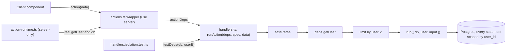

# PromptHub
## P7S2 Action Contracts

| `Title` | `Created` | `Last modified` |
|---------|-----------|-----------------|
| P7S2 Action Contracts | 29/10/2026 16:50 GMT+10 | 29/10/2026 17:01 GMT+10 |

## Table of Contents
- [Purpose](#purpose)
- [The Seam](#the-seam)
  - [Types](#types)
  - [runAction](#runaction)
  - [Wrapper shape](#wrapper-shape)
  - [What the seam leaves untested](#what-the-seam-leaves-untested)
- [Action Matrix](#action-matrix)
- [Schemas](#schemas)
- [Folders](#folders)
- [ensureProfileExists](#ensureprofileexists)
- [Auth](#auth)
- [Prompts, Tags and History](#prompts-tags-and-history)
- [Sign-out Purge and the Workspace Cache](#sign-out-purge-and-the-workspace-cache)
- [Test Conventions](#test-conventions)
- [Composite Tenant Keys](#composite-tenant-keys)

## Purpose

The interfaces and per-action rules for [the PRP](../P7S2-server-side-security-hardening.md). The decisions behind them
(the injected seam, the interpretation of "every action") are in
[the PRP's Decisions](../P7S2-server-side-security-hardening.md#decisions); the task order and the red tests are in
[the task briefs](P7S2-task-briefs.md#briefs). Every file path below was read on 29/10/2026 against `master` at
`bff5fa6`. Code in this document is a contract, not a finished implementation: an executing agent writes the tests
first, checks each cited symbol against the code, and reports a disagreement instead of working around it.

## The Seam

Decision Q1 (developer, 27/10/2026): the body of each action becomes a function of a plain module that takes its
dependencies and its input, and the `"use server"` export becomes a one-line wrapper. A test drives the body with the
`src/test/db.ts` client and a fake `getUser`, so no Next.js internals, no GoTrue and no module mock are involved. This
extends the convention of `src/features/editor/service.ts`, whose functions take `(db, userId, input)`.

There are two layers and they stay distinct. A handler is the body of one action: `(deps, data: unknown)`, which parses,
authenticates, rate-limits and runs. The editor service (`saveVersion`, `listVersions`, ...) remains the lower layer a
handler delegates to when a transaction is worth testing on its own.

### Types

```typescript
// src/lib/action-runner.ts  (plain module: no "use server", no next/* import; imports "server-only")
import type { PrismaClient } from "@prisma/client"
import type { z } from "zod"
import type { ActionResult } from "@/types/actions"

/** The signed-in user as a handler needs it: id and email from supabase.auth.getUser(). */
export interface ActionUser { id: string; email: string | null }

/** What a handler is given. The real values are built in src/lib/action-runtime.ts; a test passes its own. */
export interface ActionDeps {
  /** Resolves the authenticated user, or null. Real: supabase.auth.getUser() on the request's cookies. */
  getUser: () => Promise<ActionUser | null>
  /** The Prisma client. Real: @/lib/db. A test passes the useTestDatabase client. */
  db: PrismaClient
}

/** Which limiter applies: shared mutation (30/min), save (30/min, saveNewVersion and restorePromptVersion), autosave, none. */
export type LimitClass = "mutation" | "save" | "autosave" | "none"

export interface ActionSpec<I, O> {
  /** Logged with an unexpected error: `${name} error:`. */
  name: string
  /** Parses `data`; a schema with defaults has a wider input than output, hence the third type argument. */
  schema: z.ZodType<I, z.ZodTypeDef, unknown>
  /** The message for a failed parse, e.g. "Invalid prompt ID". Never a Zod message: it can echo the input. */
  invalid: string
  /** The message for an unexpected error, e.g. "Failed to rename prompt". */
  failure: string
  limit: LimitClass
  /** Call ensureProfileExists(db, userId) after the limit and before `run` (createPrompt, createFolder, profile). */
  ensureProfile?: boolean
  // The sketches in this document write `userId` for `user.id`.
  run: (ctx: { db: PrismaClient; user: ActionUser; input: I }) => Promise<ActionResult<O>>
}
```

### runAction

```typescript
export async function runAction<I, O>(deps: ActionDeps, spec: ActionSpec<I, O>, data: unknown): Promise<ActionResult<O>>
```

The order is fixed and is the order `createPrompt` and `saveNewVersion` use today, so no action changes its observable
order of checks:

```text
1. parsed = spec.schema.safeParse(data)          fail -> { success: false, error: spec.invalid }   (getUser not called)
2. user = await deps.getUser()                   null -> { success: false, error: "Unauthorized. Please sign in." }
3. limit (user.id)                               over -> { success: false, error: "Too many requests. Please slow down." }
4. if spec.ensureProfile: await ensureProfileExists(deps.db, user.id)
5. return await spec.run({ db: deps.db, userId: user.id, input: parsed.data })
catch (error): rethrow when error is an object with a string `digest` (NEXT_REDIRECT, NEXT_NOT_FOUND, DYNAMIC_SERVER_USAGE: the
               control-flow errors Next 14.2 builds with a digest; the one place this check lives; issue #51);
               otherwise console.error(`${spec.name} error:`, error) and return { success: false, error: spec.failure }
```

Steps 1 to 5 sit inside the `try`, so a rejected `getUser()` (a cookie or Supabase failure) becomes `spec.failure`. The
tenant boundary is the arguments `run` receives: `user` comes only from step 2 and `input` carries no user id, so a
handler cannot scope a query by a value the client chose.

`checkMutationRateLimit` exists in `src/lib/rate-limit.ts` (30 per 60 s per identifier, store `mutation`). Task 2 adds
`checkSaveRateLimit` (store `save`, 30 per 60 s: `saveNewVersion` and `restorePromptVersion` use it, decision D4) and
`checkAutosaveRateLimit` (store `autosave`); every other mutation keeps `mutation`. The PRP proposes 240 per 60 s: autosave writes
500 ms after the last change, so at most 120 writes a minute are possible, and the limit leaves twice that. The number
is a judgement the developer may change. Reads are not limited (decision Q3 names mutations).

### Wrapper shape



Not rendered (the project has no render step). The tests enter at `H`; nothing automated covers `W` and `X`.

```typescript
// src/features/folders/actions.ts
"use server"

import { revalidatePath } from "next/cache"
import { actionDeps } from "@/lib/action-runtime"
import * as handlers from "./handlers"
import type { CreateFolderInput } from "./schemas"

export async function createFolder(data: CreateFolderInput) {
  const result = await handlers.createFolder(actionDeps, data)
  if (result.success) revalidatePath("/")
  return result
}
```

```typescript
// src/lib/action-runtime.ts  (imports "server-only"; the only module that imports @/lib/db and the Supabase server client
// for actions; no test imports it, because it needs a request's cookies and the developer's DATABASE_URL)
export const actionDeps: ActionDeps = {
  db,
  getUser: async () => {
    const { data: { user } } = await createClient().auth.getUser()
    return user ? { id: user.id, email: user.email ?? null } : null
  },
}
```

Rules for a wrapper file: it exports only `async function`s (a type export is erased and allowed); each body delegates
once, plus the `revalidatePath` calls that exist today; the parameter type is `z.input<typeof schema>` so call sites
type-check, while the handler still takes `unknown` and parses; an action that already takes `data: unknown` keeps it.
`createClient()` is called inside `getUser`, never at module load, because `cookies()` throws outside a request.

### What the seam leaves untested

The wrappers, `action-runtime.ts` and the Supabase cookie wiring are not covered by a unit test: they need a request
scope and a GoTrue. The research on 26/10/2026 showed that driving them from a test needs Next internals (the request
async storage, the cookies adapter and a static-generation store) and a fake auth server, and that it bypasses the
`src/test/db.ts` guard. The wrappers are exempt from the per-file coverage target and are checked by the build
(`npm run build` fails on a non-async export of a `"use server"` file), by the manifest count in
[the validation loop](../P7S2-server-side-security-hardening.md#level-3-build-and-browser) and by the browser checks.

## Action Matrix

The 25 actions that remain after the PRP. Today 27 functions are exported from the eight `"use server"` modules;
`ensureProfileExists` stops being an action (Task 1) and `searchPrompts` stops being one (decision D3: its only caller
is `getPromptsByFolder`, verified by search on 29/10/2026). Limit classes: M mutation, S save, A autosave, - none, IP the
existing per-IP auth limiter. "Returns" is the `data` of the success result.

| Action | Wrapper file | Input | Limit | Ownership rule | Returns |
|---|---|---|---|---|---|
| `signUp` | `auth/actions.ts` | `SignUpSchema` | IP | no tenant data | `{ redirectTo }` |
| `signIn` | `auth/actions.ts` | `SignInSchema` | IP | no tenant data | `{ redirectTo }` |
| `signOut` | `auth/actions.ts` | none | - | no tenant data | redirects; keeps its body, no handler, no isolation test |
| `getRootFolders` | `folders/actions.ts` | none | - | `user_id` | `Folder[]` |
| `createFolder` | `folders/actions.ts` | `{ name, parentId \| null }` | M | parent owned, same transaction | `Folder` |
| `renameFolder` | `folders/actions.ts` | `{ folderId, name }` | M | `update` where `{ id, user_id }` | `Folder` |
| `deleteFolder` | `folders/actions.ts` | `{ folderId }` | M | tree scoped by `user_id`; `deleteMany` where `{ id, user_id }` | `{ folderIds, promptIds }` |
| `getFolderChildren` | `folders/actions.ts` | `{ parentId }` | - | `user_id`; a foreign parent gives `[]` | `Folder[]` |
| `getPromptsByFolder` | `prompts/actions.ts` | `{ folderId, query?, tagIds? }` | - | `user_id`; a foreign folder gives `[]` | `PromptListItem[]` |
| `createPrompt` | `prompts/actions.ts` | existing | M | folder owned, same transaction | `PromptListItem` |
| `getPromptDetails` | `prompts/actions.ts` | existing | - | `findFirst` where `{ id, user_id }` | prompt with folder, no `tags` |
| `renamePrompt` | `prompts/actions.ts` | `{ promptId, newTitle }` | M | `updateMany` where `{ id, user_id }` | `void` |
| `deletePrompt` | `prompts/actions.ts` | `{ promptId }` | M | `deleteMany` where `{ id, user_id }` | `void` |
| `validatePrompts` | `prompts/actions.ts` | `{ promptIds }` | - | `user_id` | `{ validIds }` |
| `getTags` | `prompts/tag-actions.ts` | existing | - | `user_id` | `Tag[]` |
| `createTag` | `prompts/tag-actions.ts` | existing | M | `user_id` | `{ id, name }` |
| `assignTagsToPrompt` | `prompts/tag-actions.ts` | existing | M | prompt and tags owned; write scoped | `void` |
| `getPromptVersionHistory` | `prompts/history-actions.ts` | existing | - | service (`listVersions`) | versions |
| `restorePromptVersion` | `prompts/history-actions.ts` | existing | S | service (`restoreVersion`) | `{ title, content }` |
| `saveNewVersion` | `editor/actions.ts` | existing | S | service (`saveVersion`) | `{ versionId }` |
| `autoSavePrompt` | `editor/actions.ts` | existing | A | service (`autoSaveDocument`) | `void` |
| `getProfileDetails` | `profile/actions.ts` | none | - | own profile | `{ id, email, displayName, createdAt }` |
| `updateDisplayName` | `profile/actions.ts` | `{ displayName }` | M | own profile | `{ displayName }` |
| `getWorkspaceSnapshot` | `workspace/actions.ts` | none | - | `user_id` | `{ userId, folders, prompts, loadedAt }` |
| `getDashboardMetrics` | `dashboard/actions.ts` | none | - | `user_id` | `DashboardMetrics` |

Decision D2 (see the PRP) reads "every action returns `ActionResult`" as the eleven that do not today: the five folder
actions, `getPromptsByFolder`, `getTags`, both profile actions and `getWorkspaceSnapshot`, plus `searchPrompts`, which
is no longer an action. The developer's strict reading of Q4 (29/10/2026) adds `getDashboardMetrics`: it returns `ActionResult` too, and the
dashboard page renders zeros when it fails. Only `signOut` keeps its own shape and its body, because it redirects. That
makes 24 wrappers over handlers: 22 tenant actions, each with an isolation test, plus `signIn` and `signUp`, which are
covered by `auth/handlers.test.ts` titled `"signIn: ..."` and `"signUp: ..."`; `signOut` has no handler and no test of
this kind (no tenant data).

The `invalid` and `failure` texts of each spec (the unauthorised and over-limit texts are the runner's). "(existing)"
means the action returns that text today.

| Action | `invalid` | `failure` |
|---|---|---|
| `getRootFolders`, `getWorkspaceSnapshot`, `getProfileDetails`, `getDashboardMetrics` | "Invalid input data" | "Failed to load folders", "...workspace", "...profile", "...dashboard" |
| `createFolder` / `renameFolder` / `deleteFolder` / `getFolderChildren` | "Invalid folder name or parent" / "Invalid folder name" / "Invalid folder ID" / "Invalid folder ID" | "Failed to create folder" / "...rename folder" / "...delete folder" / "Failed to load folders" |
| `getPromptsByFolder` | "Invalid folder ID" | "Failed to load prompts" |
| `createPrompt`, `getPromptDetails` | "Invalid input data", "Invalid prompt ID" (existing) | "Failed to create prompt", "Failed to fetch prompt details" (existing) |
| `renamePrompt` / `deletePrompt` / `validatePrompts` | "Invalid title" / "Invalid prompt ID" / "Invalid prompt list" | "Failed to rename prompt" / "...delete prompt" / "...validate prompts" (existing) |
| `getTags` / `createTag` / `assignTagsToPrompt` | "Invalid input data" (all) | "Failed to load tags" / "Failed to create tag" / "Failed to assign tags" (last two existing) |
| `getPromptVersionHistory` / `restorePromptVersion` | "Invalid prompt ID" / "Invalid restore request" (existing) | "Failed to fetch prompt history" / "Failed to restore prompt version" (existing) |
| `saveNewVersion` / `autoSavePrompt` | "Invalid input data" (existing) | "Failed to save version" / "Failed to auto-save" (existing) |
| `updateDisplayName` | "Invalid display name" | "Failed to update profile" |

`saveNewVersion` keeps its second check, `titleValidationSchema`, as the first statement of `run`; a failure returns
"Please provide a valid title for your document". It therefore runs after authentication and the limit, where it ran
before authentication today: an unauthenticated caller with a placeholder title now gets the unauthorised text.

## Schemas

Every schema trims before it bounds: in Zod 3.25.76 `z.string().min(1).max(5).trim()` accepts `"  "` and returns `""`.
`.uuid()` accepts any version and upper case, which is acceptable for a lookup key. The caps below are the PRP's
judgement (there was no cap on folder names or display names before; a prompt title cap of 200 exists in
`prompts/schemas.ts`), and bound the growth that finding F-1 describes.

```typescript
// src/features/folders/schemas.ts  (CREATE)
const folderId = z.string().uuid("Invalid folder ID")
const folderName = z.string().trim().min(1, "Folder name is required").max(100, "Folder name is too long")
export const createFolderSchema = z.object({ name: folderName, parentId: folderId.nullable() })
export const renameFolderSchema = z.object({ folderId, name: folderName })
export const deleteFolderSchema = z.object({ folderId })
export const getFolderChildrenSchema = z.object({ parentId: folderId })
export const noInputSchema = z.undefined()   // getRootFolders and the other no-argument actions

// src/features/prompts/schemas.ts  (MODIFY: add)
const promptId = z.string().uuid("Invalid prompt ID")
export const renamePromptSchema = z.object({
  promptId,
  newTitle: z.string().trim().min(1, "Title required").max(200, "Title too long")
    .refine((value) => !isPlaceholderTitle(value), "Please provide a custom title for your document"),
})
export const deletePromptSchema = z.object({ promptId })
// Reason: not .uuid(): a stale persisted tab may hold any string, and one failing element would fail the whole
// batch and leave every orphaned tab open. The ids only feed a parameterised `in` list.
export const validatePromptsSchema = z.object({ promptIds: z.array(z.string().min(1).max(64)).max(200) })
export const getPromptsByFolderSchema = z.object({
  folderId: z.string().uuid("Invalid folder ID"),
  query: z.string().trim().max(200).optional(),
  tagIds: z.array(z.string().uuid("Invalid tag ID")).max(20).optional().default([]),
})

// src/features/profile/schemas.ts  (CREATE)
export const updateDisplayNameSchema = z.object({ displayName: z.string().trim().max(100, "Display name is too long") })
```

`createPromptSchema` already caps `title` at 200 and `saveNewVersionSchema` and `autoSaveSchema` cap content at
500,000 characters (`src/features/editor/schemas.ts:23`). The auth schemas in `src/features/auth/schemas.ts` are used
by `AuthForm` and stay as they are. Rejecting a placeholder title in `renamePromptSchema` is new behaviour (a rename to
`[Untitled Doc]` succeeds today); it matches what `saveNewVersion` already enforces.

## Folders

`src/features/folders/handlers.ts` holds `getRootFolders`, `createFolder`, `renameFolder`, `deleteFolder` and
`getFolderChildren`. Each is `runAction(deps, spec, data)`. Messages: invalid input "Invalid input data" (a more
specific text where the caller shows it), unauthorised and over-limit as in the runner, not found
"Folder not found or access denied" for a missing and a foreign id alike, failures "Failed to create folder" and so on.

`createFolder` verifies the parent inside the transaction that creates the folder. The check is sufficient without a
lock because `user_id` of a folder is never updated by any action, so ownership cannot change between the read and the
insert; a parent deleted in between raises a foreign-key error, which the runner turns into the generic failure.

```text
createFolder.run: db.$transaction(tx =>
  if parentId !== null:
    parent = tx.folder.findFirst({ where: { id: parentId, user_id: userId }, select: { id } })
    if !parent: return NOT_FOUND                       // nothing written
  folder = tx.folder.create({ data: { name, user_id: userId, parent_id: parentId } })
  return { success: true, data: folder })
```

`renameFolder` is one `db.folder.update({ where: { id: folderId, user_id: userId }, data: { name } })`; Prisma raises
`P2025` when no row matches, and the handler maps that code to NOT_FOUND (the shared test is whether the error is a
`Prisma.PrismaClientKnownRequestError` with `code === "P2025"`; a helper in `src/lib/prisma-errors.ts` serves the
folder and tag handlers). The existing code already uses the `{ id, user_id }` unique-where form for `update`.

`deleteFolder` returns every folder id and every prompt id the cascade removes, which is what issue #43 asks for and
what the client needs to purge its caches (finding F-6). Both statements run in one transaction:

```sql
-- tagged $queryRaw, parameterised; table names are Prisma's (no @@map), as in the existing search query
WITH RECURSIVE tree AS (
  SELECT id FROM "Folder" WHERE id = ${folderId} AND user_id = ${userId}
  UNION   -- not UNION ALL: it terminates even if corrupt data holds a cycle
  SELECT f.id FROM "Folder" f JOIN tree t ON f.parent_id = t.id WHERE f.user_id = ${userId}
)
SELECT 'folder' AS kind, id FROM tree
UNION ALL
SELECT 'prompt' AS kind, p.id FROM "Prompt" p WHERE p.folder_id IN (SELECT id FROM tree) AND p.user_id = ${userId}
```

```text
deleteFolder.run: db.$transaction(tx =>
  rows = tx.$queryRaw(above)
  if rows has no 'folder' row: return NOT_FOUND         // missing or foreign: indistinguishable
  deleted = tx.folder.deleteMany({ where: { id: folderId, user_id: userId } })   // cascades to children and prompts
  if deleted.count === 0: return NOT_FOUND
  return { success: true, data: { folderIds, promptIds } })
```

Limitations, stated rather than hidden. A prompt another session of the same user creates in a descendant folder
between the two statements is cascade-deleted without being in `promptIds`, so a tab for it would stay open; only a
second session of the same user can cause it, and no lock is taken. The depth of a folder tree is unbounded on the
server (the tree UI stops at depth 5, `FolderItem.tsx` `MAX_DEPTH`); the recursion is bounded by the user's own rows.
A per-user folder count cap is not in this PRP (finding F-1, filed separately).

`getFolderChildren` for a parent the user does not own returns `{ success: true, data: [] }`, the same as an owned
parent with no children, so the action is not an oracle for folder ids.

The optimistic folders the UI creates carry ids such as `temp-<timestamp>`. An action on one before the server answers
now fails Zod ("Invalid folder ID") instead of failing at the database. The PRP accepts that and adds no guard: the
callers' existing rollback and error toast handle it. After a delete the callers clear exactly the workspace cache
(`foldersByParent`, `rootFolders`, `promptsByFolder`, `promptsById`) for the returned ids and close the tabs of the
returned prompt ids. They leave the document cache alone (its entries for deleted prompts are unreachable and are
emptied at sign-out) and `expandedFolders` (a stale id is harmless). Name and list caps are enforced on the server only:
the folder dialogs have no `maxLength` and show the server's text in the existing error toast, which is a smaller change
than mirroring the schemas in the client forms.

## ensureProfileExists

`src/lib/ensure-profile.ts` loses `"use server"` and gains `import "server-only"`. It takes the client as an argument,
like the editor service, so a test can run it against the disposable database:

```typescript
export type ProfileDb = Pick<PrismaClient, "profile">

export async function ensureProfileExists(db: ProfileDb, userId: string): Promise<void> {
  // Reason: createMany with skipDuplicates sends INSERT ... ON CONFLICT DO NOTHING: it cannot raise P2002 and writes
  // nothing for an existing profile. upsert({ update: {} }) fell back to SELECT then INSERT and raced in 205 to 210 of
  // 240 concurrent first calls (observed 26/10/2026, not in the Prisma documentation); createMany passed all 240.
  await db.profile.createMany({ data: [{ id: userId }], skipDuplicates: true })
}
```

The function keeps taking the id from its caller. When email confirmation is on, `signUp` returns a user and no session,
so a helper that read the user from `getUser()` would find nobody (`src/features/auth/actions.ts:39-41`). Callers after
the PRP: `runAction` (`ensureProfile: true`) and the auth handlers. Issue #40's acceptance says `upsert`; the
developer chose `createMany` with `skipDuplicates` on 29/10/2026 because the `upsert` form rests on undocumented Prisma
behaviour, and the completion comment on #40 states the deviation. `createMany` returns a count and no row, which is
all the callers need.

## Auth

`src/features/auth/handlers.ts` holds `signUp` and `signIn`. They cannot use `runAction` (there is no user yet), so
they have their own deps, exported from `action-runtime.ts` as `authDeps` beside `actionDeps`:

```typescript
export interface AuthDeps {
  db: PrismaClient
  /** The first x-forwarded-for value or "unknown". Real: headers().get(...) in action-runtime.ts. */
  clientIp: () => string
  /** Built per call, because createClient() reads the request's cookies. */
  auth: () => Pick<SupabaseClient["auth"], "signInWithPassword" | "signUp">
}
```

Flow: parse with `SignInSchema` or `SignUpSchema` (a failure returns the fixed text "Check your email and password and
try again."), limit by IP with `checkAuthRateLimit`, call Supabase with exactly `{ email, password }` (never the parsed
object or the raw input, so `confirmPassword` and any `options` a direct POST adds never reach Supabase), then
`ensureProfileExists` for the returned user, logged and ignored on failure as today. Supabase's `error.message` and any
thrown message are no longer returned. The fixed messages:

| Case | Message |
|---|---|
| Invalid input | "Check your email and password and try again." |
| Over the IP limit | "Too many attempts. Please try again later." (unchanged) |
| `signIn` rejected, `error.code` of `email_not_confirmed` | "Confirm your email address before signing in." |
| `signIn` rejected, any other error | "Invalid email or password." |
| `signUp` rejected, `error.code` of `weak_password` | "Choose a stronger password." |
| `signUp` rejected, any other error | "Could not create the account." |
| Any thrown error | "Something went wrong. Please try again." |

`AuthError.code` is typed `ErrorCode | string | undefined` in the installed `@supabase/auth-js` 2.64.2 and its
`ErrorCode` union contains `email_not_confirmed`, `weak_password`, `user_already_exists` and `email_exists`. Whether the
cloud project's GoTrue sends a `code` for these cases is not verified: with no code, every rejection takes the generic
message, which is safe and less helpful. The Docker stack check in the browser list confirms the two special cases.
`signOut` stays in the wrapper file (it calls `redirect`, and a handler must not): it reads the session, signs out,
revalidates and redirects, as now.

## Prompts, Tags and History

`src/features/prompts/handlers.ts` (create, details, rename, delete, validate, list by folder),
`search-handlers.ts` (the full-text query, not an action), `tag-handlers.ts`, and `history-handlers.ts` (thin: parse,
authenticate, delegate to `listVersions` and `restoreVersion` of `@/features/editor/service`). The editor's actions get
`src/features/editor/handlers.ts` (`saveNewVersion` and `autoSavePrompt` delegating to `saveVersion` and
`autoSaveDocument`). The four wrapper files are the split of issue #51: `actions.ts` (the six CRUD and listing
actions), `tag-actions.ts`, `history-actions.ts`, and the editor's own.

`createPrompt` checks the folder in the same transaction as the create, closing finding F-2 for prompts. The existing
duplicate-title check moves into the transaction unchanged (it is not atomic with the insert and there is no unique
index; that is out of scope):

```text
createPrompt.run: db.$transaction(tx =>
  folder = tx.folder.findFirst({ where: { id: folderId, user_id: userId }, select: { id } })
  if !folder: return { success: false, error: "Folder not found or access denied" }
  if title: duplicate check as today -> the existing "already exists" message
  prompt = tx.prompt.create({ data: { user_id: userId, folder_id: folderId, title: title ?? null, content: "" } })
  return { success: true, data: { ...prompt, tags: [] } })   // tags: [] stays: the list item type has it
```

`renamePrompt` keeps its two reads and the single scoped `updateMany`; only the input is now parsed. `deletePrompt` and
`validatePrompts` change only by the schema. `getPromptDetails` drops the `tags: []` field: nothing reads it
(`EditorPane` and `useMigration` use the row and its folder; searched on 29/10/2026), and issue #51 allows dropping it.

`assignTagsToPrompt` keeps the ownership reads (prompt, then `count` of the user's tags equals the unique ids) and
replaces the unscoped write at `src/features/prompts/actions.ts:588` with
`tx.prompt.update({ where: { id: promptId, user_id: userId }, data: { tags: { set } } })`, with the reads and the write
in one transaction. `updateMany` cannot be used because it does not accept a relation `set`; the `{ id, user_id }`
unique-where form of `update` scopes the write and raises `P2025` for a row that stopped being the user's, mapped to
"Prompt not found or access denied".

`getPromptsByFolder` calls the search handler's function when `query` is non-blank and otherwise lists with the same
`user_id` and `folder_id` filter as today. A foreign or unknown folder gives `[]`. The raw query in `search-handlers.ts`
is already a tagged template scoped by `user_id`; it moves unchanged.

## Sign-out Purge and the Workspace Cache

Sign-out today calls `clearDocumentCache()` only (`src/components/layout/Header.tsx:38-42`). The purge is one client
function, `purgeClientState` in `src/features/auth/client-purge.ts`, called by `handleSignOut` before `signOut()`:

```typescript
export interface PurgeStorage {
  readonly length: number
  key(index: number): string | null
  removeItem(key: string): void
}
export const DRAFT_KEY_PREFIX = "prompt-"   // with the hyphen: prompthub-tabs-state and prompthub:user-settings:v1 also start with "prompt"
export function purgeClientState(storage: PurgeStorage | null = browserStorage()): void
```

It does five things, each independent of the others failing: `clearDocumentCache()`; `clearWorkspaceCache()`; remove
every storage key that starts with `prompt-` (the draft `prompt-v1-<id>`, its stash `prompt-v1-<id>:conflict` and the
legacy `prompt-<id>`; collect the keys first, then remove, because removal shifts `key(index)`); `resetTabs()` on the
tab store (Q7); and `resetSession()` on the UI store. A blocked or throwing storage skips only the key removal. The
tab store persists `tabs` and `activeTabId` under `prompthub-tabs-state`, so `resetTabs()` leaves
Zustand's envelope `{"state":{"tabs":[],"activeTabId":null},"version":0}` on disk (`resetTabs` also resets `layout`
and drops pinned tabs), which removes the previous user's document titles. `resetSession()` is a
judgement beyond the issue text: the UI store holds the previous user's selection and `prompts` (with content) in
memory, and `router.replace` does not reload the page. Two new store actions are needed: `resetTabs` on `src/stores/use-tab-store.ts` (and `TabState` in
`src/features/tabs/types.ts`) and `resetSession` on `src/stores/use-ui-store.ts`.

The workspace cache (`src/features/workspace/cache.ts`) stores the snapshot's `userId` and never checks it. Issue #44
asks that its getters return nothing for a different user id. Decision D5 does that with a bound viewer rather than a
parameter on every getter, because the getters have five call sites and a test (`useActiveTabFolderSync.test.tsx`) that
the PRP must not edit:

```text
viewer = ""                                        // module state; "" means no user bound yet
clearWorkspaceCache():            empty every map; viewer = ""
bindWorkspaceCacheViewer(userId): if viewer !== userId: empty every map; viewer = userId
hydrateWorkspaceCache(snapshot):  if viewer === "": viewer = snapshot.userId           // fresh module or after a purge: the cache is empty
                                  if snapshot.userId !== viewer: return                 // a late snapshot of another user changes nothing
                                  otherwise as today
```

Every getter and writer then reads and writes only what belongs to the bound viewer, because binding another viewer
empties the maps first. `WorkspacePreloader` receives `userId` from `src/app/(app)/layout.tsx` (a Server Component that
already holds `data.user`) and binds in its first effect, unconditionally and before it reads the preload setting
(`preloadWorkspaceOnLaunch` in `prompthub:user-settings:v1` can turn the preload off, and the bind must not depend on it). It is rendered before the panels, so its effect runs before
theirs (effects run in tree order, an earlier sibling's subtree first); if that order ever changed, the failure is a
brief display of the previous user's folder names until the fetch replaces them, not a lasting leak. This path matters
when a session expires and the next user signs in without the purge having run (`router.replace` keeps module state).
Drafts are not purged on that path (the draft keys carry prompt ids, which another user never opens), and neither is the
tab store: that is a stated limitation and a candidate follow-up, not part of this PRP.

`removeFolderFromCache(folderId, parentId)` becomes `removeFolderTreeFromCache({ folderIds, promptIds })`, driven by the
ids `deleteFolder` returns (finding F-6): it deletes each folder id from every `foldersByParent` list and map key, each
folder id from `promptsByFolder`, each prompt id from `promptsById`, and refreshes `rootFolders`.

`resetSession` sets `expandedFolders` to an empty set, `selectedFolder` and `selectedPrompt` to null, `prompts` to `[]`,
`folderFilter` and `docFilter` to `""`, `selectedTagIds` to `[]` and `workspaceLoadedAt` to null; sort orders and the
refetch counters stay.

Ask first (developer, 29/10/2026). Purging discards work, so `handleSignOut` confirms before it purges when unsaved work
exists. `hasUnsavedClientWork(storage)` in `client-purge.ts` is true when any tab has `isDirty` or the storage holds any
key starting with `prompt-`: a `prompt-v1-<id>` draft exists only while the working text differs from the server's, and
the `:conflict` stash and the legacy `prompt-<id>` are kept text by design. The Header shows an `AlertDialog`
(`src/components/ui/alert-dialog.tsx`: "Sign out and discard unsaved work?", Cancel and Sign out); Cancel changes
nothing, Sign out purges and calls `signOut()`. With no unsaved work it signs out at once. Limitation, stated: the check
and the purge see only this browser tab's memory and the shared `localStorage`. Another open tab of the same browser
keeps its caches and tab state in memory, is not asked, and may rewrite a draft after the purge; once the cookies are
cleared its server calls return the unauthorised text. The PRP does not coordinate tabs (no `storage` event, no
`BroadcastChannel`).

## Test Conventions

Each area has `handlers.test.ts` for behaviour and `handlers.isolation.test.ts` for the tenant boundary, both inside
`describeDb` from `src/test/db.ts` where they need rows. The tests import the handler module, never an `actions.ts`
file and never `@/lib/db`, `action-runtime.ts` or Supabase code. A fake `ActionDeps` comes from
`src/test/action-deps.ts` (Task 3): `testDeps(db, userId)` returns `{ db, getUser: async () => ({ id: userId }) }`, and
`signedOutDeps(db)` returns a `getUser` that resolves null. The auth tests pass a fake `auth` object that records its
arguments; that is an injected seam with a real default, not a mock of a repository module.

An isolation test is named `"<actionName>: user B ..."` so that the coverage rule can find it
([Task 10](P7S2-task-briefs.md#p7s2t10-isolation-coverage-rule)). It creates user A's rows with the factories, calls the
handler as user B with A's ids, and asserts two things: the result equals what a missing id returns (so the response
cannot tell the two apart), and A's rows are unchanged, read back with the test client. A read action asserts that B's
result contains none of A's data. The suites generate their ids with `randomUUID` through `createTestUser`, so parallel
runs against one database do not collide, and they delete what they created in `afterAll` through `deleteTestUser`.
`Tag` has no relation to `Profile` in `prisma/schema.prisma`, so deleting a profile does not delete its tags:
`deleteTestUser` removes them first.

The mutation limiter is keyed by user id and keeps 30 per minute per process. A suite that needs the limit to fire uses
a fresh user and calls the action 31 times; a suite that does not should stay well under 30 mutations per user.

The auth tests are titled `"signIn: ..."` and `"signUp: ..."` so the coverage rule finds them. Each worker's Prisma
client opens its default pool (2 x CPUs + 1 connections), and a dozen parallel suites against one default Postgres
(`max_connections` is 100 by default; unverified here) can exhaust it, so `useTestDatabase` appends
`connection_limit=5` to the URL unless it already has one. `assertSafeTestDatabaseUrl` rejects only the `host`,
`hostaddr` and `port` query parameters (read in `src/test/db.ts`), so the parameter passes the guard. A test that needs
a row to vanish between a handler's read and its write (the `P2025` path of `renameFolder` and `assignTagsToPrompt`)
uses `src/test/racing-db.ts`, which mirrors `src/test/failing-db.ts`: a Proxy over the real client that deletes the named
row immediately before the first `update` call and then delegates, so the real database raises the real `P2025`.

## Composite Tenant Keys

## Composite Tenant Keys

Developer decision, 29/10/2026 (Q8 reversed): the database enforces what the application checks. The change, validated
with `prisma validate` and previewed with `prisma migrate diff` on 29/10/2026 against a scratch copy of the schema
(no database, no client generated):

```prisma
model Folder {
  parent  Folder? @relation("NestedFolders", fields: [parent_id, user_id], references: [id, user_id], onDelete: Cascade)
  // ... unchanged fields ...
  @@unique([id, user_id])
}
model Prompt {
  folder  Folder? @relation(fields: [folder_id, user_id], references: [id, user_id], onDelete: Cascade)
}
```

```sql
-- the script `prisma migrate diff` printed
ALTER TABLE "Folder" DROP CONSTRAINT "Folder_parent_id_fkey";
ALTER TABLE "Prompt" DROP CONSTRAINT "Prompt_folder_id_fkey";
CREATE UNIQUE INDEX "Folder_id_user_id_key" ON "Folder"("id", "user_id");
ALTER TABLE "Folder" ADD CONSTRAINT "Folder_parent_id_user_id_fkey" FOREIGN KEY ("parent_id", "user_id")
  REFERENCES "Folder"("id", "user_id") ON DELETE CASCADE ON UPDATE CASCADE;
ALTER TABLE "Prompt" ADD CONSTRAINT "Prompt_folder_id_user_id_fkey" FOREIGN KEY ("folder_id", "user_id")
  REFERENCES "Folder"("id", "user_id") ON DELETE CASCADE ON UPDATE CASCADE;
```

Postgres skips a composite foreign key whose referencing columns include a NULL (the default `MATCH SIMPLE`), so a root
folder (`parent_id` NULL) and an unfiled prompt (`folder_id` NULL) stay valid. Not verified: how the generated Prisma
Client types and runs these relations (no client was generated, because that would overwrite the project's); the
Postgres-backed test of Task 13 is the check. Tags are not covered, and cannot be by this change: `Prompt.tags` is an
implicit many-to-many whose join table `_PromptToTag` has no `user_id`, `Tag.user_id` is a plain string with no foreign
key to `Profile`, and an explicit join model would change every query that reads `tags`. `assignTagsToPrompt` keeps its
application check, and audit query 3 reports existing cross-tenant links for a follow-up issue.

The audit is read-only and runs before the migration, locally and, by the developer, against Supabase:

```sql
-- 1: folders whose parent belongs to another user
SELECT c.id, c.user_id AS folder_user, c.parent_id, p.user_id AS parent_user
FROM "Folder" c JOIN "Folder" p ON p.id = c.parent_id WHERE c.user_id <> p.user_id;
-- 2: prompts whose folder belongs to another user
SELECT pr.id, pr.user_id AS prompt_user, pr.folder_id, f.user_id AS folder_user
FROM "Prompt" pr JOIN "Folder" f ON f.id = pr.folder_id WHERE pr.user_id <> f.user_id;
-- 3 (information only, not fixed here): prompts linked to another user's tag
SELECT pt."A" AS prompt_id, pt."B" AS tag_id
FROM "_PromptToTag" pt JOIN "Prompt" p ON p.id = pt."A" JOIN "Tag" t ON t.id = pt."B" WHERE p.user_id <> t.user_id;
```

If queries 1 or 2 return rows, the migration fails when it adds the constraint (Postgres refuses a foreign key that
existing rows violate) and changes nothing, because Prisma runs the migration in one transaction on PostgreSQL
(unverified here). The developer then cleans or reassigns those rows (move the folder or prompt to its owner's tree, or
delete it) and re-runs the audit before applying. The migration is generated with `prisma migrate dev --create-only`
against the local Docker Postgres and applied from scratch there; Prisma Migrate has no down migrations, so a rollback is a
new forward migration that reverses the script above (drop the two new constraints and the unique index, then re-add
`Folder_parent_id_fkey` and `Prompt_folder_id_fkey` on the single columns with `ON DELETE CASCADE ON UPDATE CASCADE`; the
agent regenerates it with `prisma migrate diff` in the opposite direction and does not apply it). Applying the migration
to Supabase is the developer's step ([Task 16](P7S2-task-briefs.md#p7s2t16-developer-checks)).
